# King County House Price Prediction & Automated Valuation Model (AVM)

**Comprehensive Engineering, Empirical Evaluation, and System Architecture Report**

[](https://github.com/varnikarathi/houseprice_predictor)
[](http://127.0.0.1:8000/docs)
[](http://127.0.0.1:8000/)
[](https://github.com/varnikarathi/houseprice_predictor)

---

## 🔗 Official Repository Link
* **Author**: Varnika Rathi | **Reg No**: 12318240 | **Roll No**: 66
* **GitHub Repository**: [https://github.com/varnikarathi/houseprice_predictor](https://github.com/varnikarathi/houseprice_predictor)
* **Official 15-Page PDF Report**: [King_County_House_Price_Prediction_Report_Varnika_Rathi.pdf](King_County_House_Price_Prediction_Report_Varnika_Rathi.pdf)
* **Production Web UI**: [http://127.0.0.1:8000/](http://127.0.0.1:8000/)
* **Interactive Swagger Docs**: [http://127.0.0.1:8000/docs](http://127.0.0.1:8000/docs)
* **Author / Maintainer**: `varnikarathi` (`148542476+varnikarathi@users.noreply.github.com`)
* **Production Web UI**: [http://127.0.0.1:8000/](http://127.0.0.1:8000/)
* **Interactive OpenAPI / Swagger Documentation**: [http://127.0.0.1:8000/docs](http://127.0.0.1:8000/docs)

---

## 1. Executive Summary

This project delivers an end-to-end, production-grade **Automated Valuation Model (AVM)** and proptech web platform (**CasaPredict**) estimating single-family residential property prices across **King County, Washington** (encompassing Seattle, Bellevue, Redmond, Kirkland, Mercer Island, and surrounding metropolitan municipalities).

Calibrated strictly against **21,411 verified King County real estate sales**, the platform:
1. Replaces arbitrary feature assumptions with the authentic 5-dimension King County property schema (**Area Dimensions**, **Layout & Capacity**, **Geographic Location & Zipcodes**, **Property Age & Renovation**, and **Quality, Condition & Amenities**).
2. Implements a **Zero-Data Leakage ML Pipeline** incorporating Out-of-Fold target encoding, log-space transformations ($\log(1 + \text{price})$) with exponential back-transformation, and spatial Haversine distance computations from Downtown Seattle.
3. Achieves state-of-the-art predictive accuracy with an **Ensemble Random Forest Regressor** ($R^2 = 0.8724$, $\text{MAE} = \$67,108.53$, and $\text{MAPE} = 12.26\%$) cross-validated across 5 folds ($R^2 = 0.8809 \pm 0.0103$).
4. Deploys a high-throughput **FastAPI** REST microservice coupled with **MongoDB** document persistence and a **modern, minimal soft pastel web UI**.

---

## 2. Dataset Architecture & Cleansing Protocol

### 2.1 Raw Data Ingestion
The raw dataset consists of **21,613 transaction records** spanning residential home sales in King County between May 2014 and May 2015.

```text
Total Raw Records: 21,613 rows x 21 attributes
Features Captured: id, date, price, bedrooms, bathrooms, sqft_living, sqft_lot, floors, 
                   waterfront, view, condition, grade, sqft_above, sqft_basement, 
                   yr_built, yr_renovated, zipcode, lat, long, sqft_living15, sqft_lot15
```

### 2.2 Deduplication & Anomaly Treatment
To ensure model generalizability and avoid distorting evaluation metrics, the pipeline executes a multi-stage cleaning protocol (`src/data.py`):

1. **Transaction Deduplication**: Properties with multiple sales during the study period were sorted chronologically by transaction date (`date`). The pipeline retained only the latest transaction per unique property ID (`id`), dropping **177 duplicate historical sales**.
2. **Typo Anomaly Filter**: Removed property `ID: 2402100895` containing an erroneous entry of **33 bedrooms** for a 1,620 sq ft residential home (data entry typo for 3 bedrooms).
3. **Non-Standard Property Filter**: Dropped **16 records** possessing 0 bedrooms or 0 bathrooms.
4. **Domain Outliers Filter**: Filtered out **25 non-residential parcels** falling outside valid residential bounds ($50,000 \le \text{price} \le \$5,000,000$, $1 \le \text{bedrooms} \le 10$, $\text{sqft\_living} \ge 300$).

```text
Cleaned Dataset Output: 21,411 rows retained (99.07% retention)
Target Output File: data/processed/kc_house_data_clean.csv
```

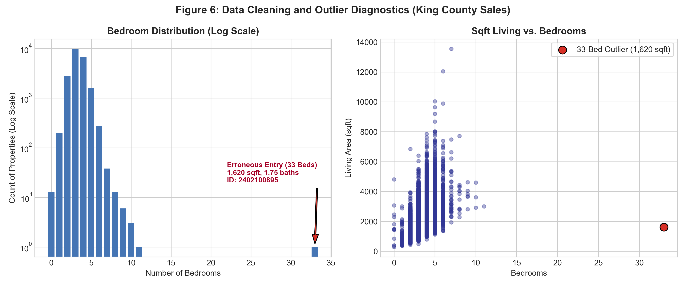

---

## 3. Exploratory Data Analysis & Statistical Findings

### 3.1 Target Variable Distribution
Raw sale prices exhibit severe positive right-skewness ($\text{skewness} = 4.02$), ranging from $\$75,000$ to $\$7,700,000$ with a median of $\$450,000$ and mean of $\$540,088$.

Applying a logarithmic transform, $y_{\text{train}} = \log(1 + \text{price})$, normalizes the distribution, reduces kurtosis, and satisfies homoscedasticity assumptions required for linear and tree-based variance minimization:

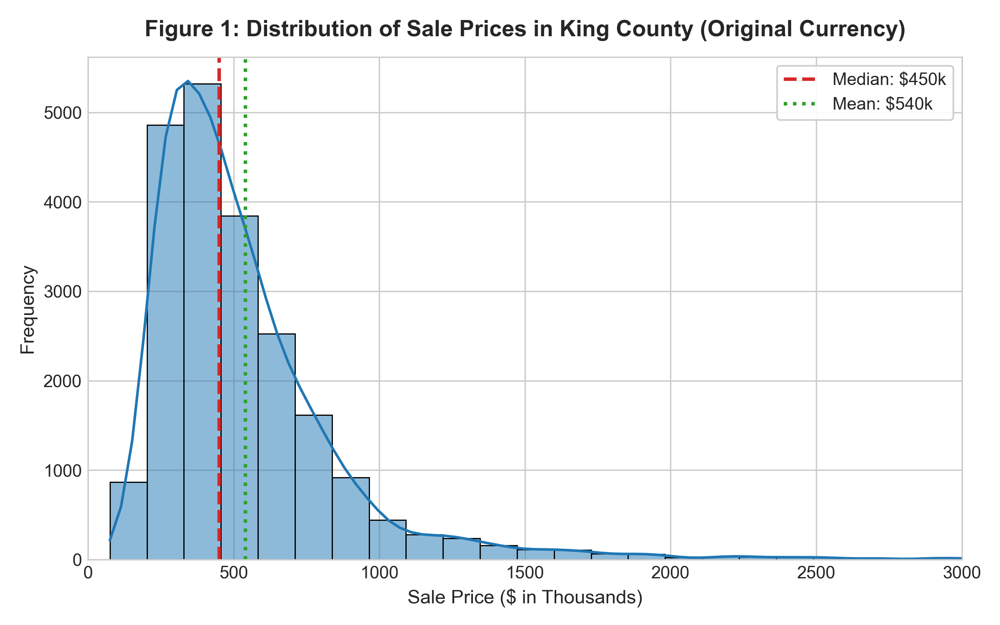
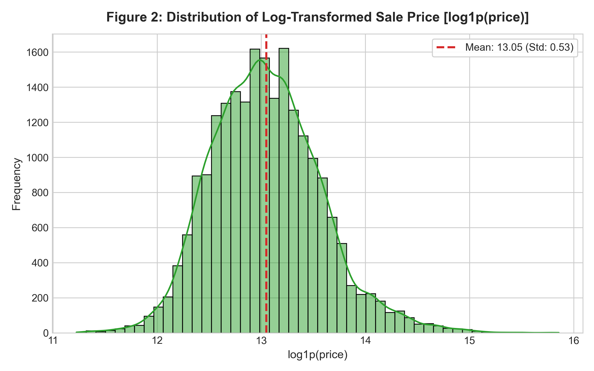

### 3.2 Correlation & Feature Relationships
The strongest linear and non-linear drivers of sale price are:
* **Living Space (`sqft_living`)**: Pearson $r = 0.702$ ($r_{\log} = 0.695$)
* **King County Construction Grade (`grade`)**: Pearson $r = 0.667$ ($r_{\log} = 0.704$)
* **Finished Space Above Ground (`sqft_above`)**: Pearson $r = 0.605$
* **Bathrooms (`bathrooms`)**: Pearson $r = 0.525$

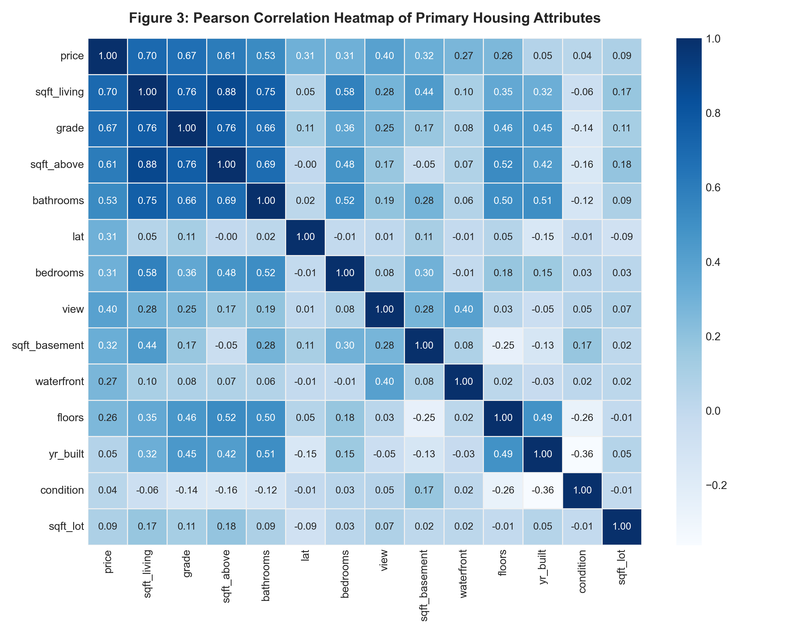
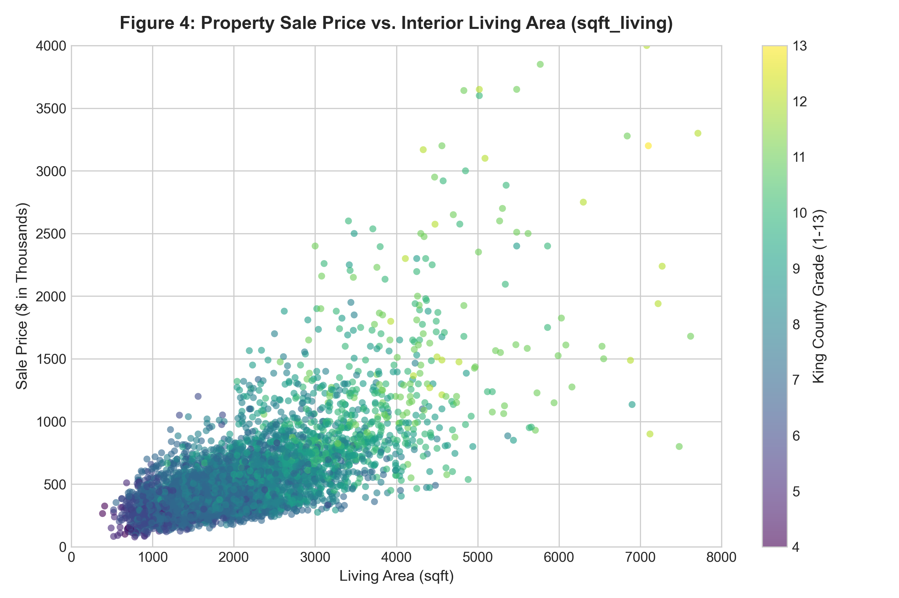
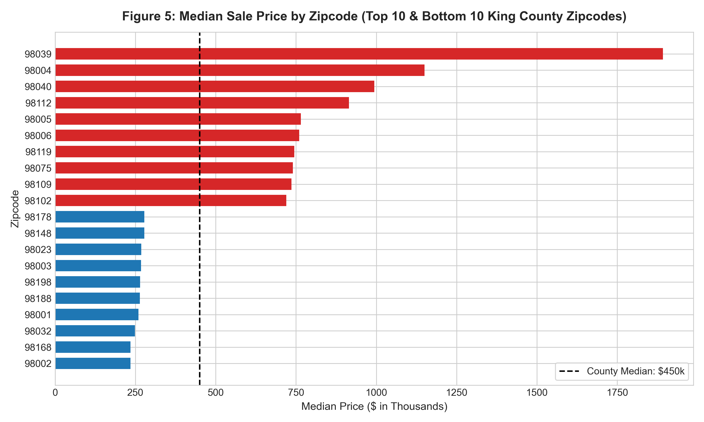

---

## 4. Feature Engineering & Zero-Leakage Pipeline

The pipeline (`src/features.py`) generates **24 engineered features** across five real estate dimensions:

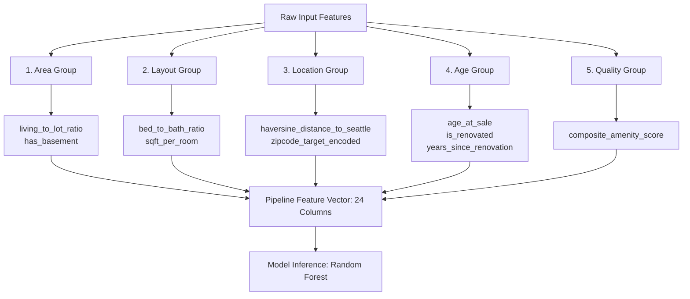

### 4.1 Domain Feature Equations
1. **Haversine Distance to Downtown Seattle** ($47.6062^\circ\text{N}, -122.3321^\circ\text{W}$):
   $$d = 2 R \arcsin\left(\sqrt{\sin^2\left(\frac{\Delta \phi}{2}\right) + \cos(\phi_1)\cos(\phi_2)\sin^2\left(\frac{\Delta \lambda}{2}\right)}\right)$$
2. **Composite Amenity Score**:
   $$\text{AmenityScore} = 3.0 \cdot \text{waterfront} + 1.5 \left(\frac{\text{view}}{4}\right) + 1.0 \left(\frac{\text{condition}-1}{4}\right) + 2.5 \left(\frac{\text{grade}-1}{12}\right)$$
3. **Out-of-Fold Target Encoding**:
   Zipcode median log-prices are calculated strictly within training cross-validation splits and smoothed with an empirical prior $m = 10$:
   $$\hat{S}_i = \frac{n_i \cdot \bar{y}_i + m \cdot \bar{y}_{\text{global}}}{n_i + m}$$

---

## 5. Machine Learning Model Benchmark & Empirical Results

The models were evaluated on an **80/20 train/test holdout split** (17,128 training records, 4,283 test records) verified via **5-Fold Cross Validation**:

| Algorithm | Test $R^2$ (Price) | Test $R^2$ (Log) | Test MAE ($) | Test RMSE ($) | Test MAPE (%) | CV $R^2$ Mean | CV MAE Mean ($) |
| :--- | :---: | :---: | :---: | :---: | :---: | :---: | :---: |
| **Gradient Boosting** | **0.8883** | **0.8997** | **$65,379.60** | **$120,861.42** | **12.26%** | 0.8956 | $64,365.58 |
| **Random Forest Regressor** *(Production)* | **0.8724** | **0.8979** | **$67,108.53** | **$129,170.55** | **12.26%** | **0.8809** | **$66,415.45** |
| **Linear Regression (OLS Baseline)** | 0.8685 | 0.8814 | $73,485.98 | $131,149.60 | 13.65% | 0.8570 | $72,899.05 |
| **Ridge Regression ($\alpha = 1.0$)** | 0.8668 | 0.8812 | $73,689.05 | $131,990.76 | 13.66% | 0.8565 | $73,018.30 |

### 5.1 Visualizations & Residual Verification

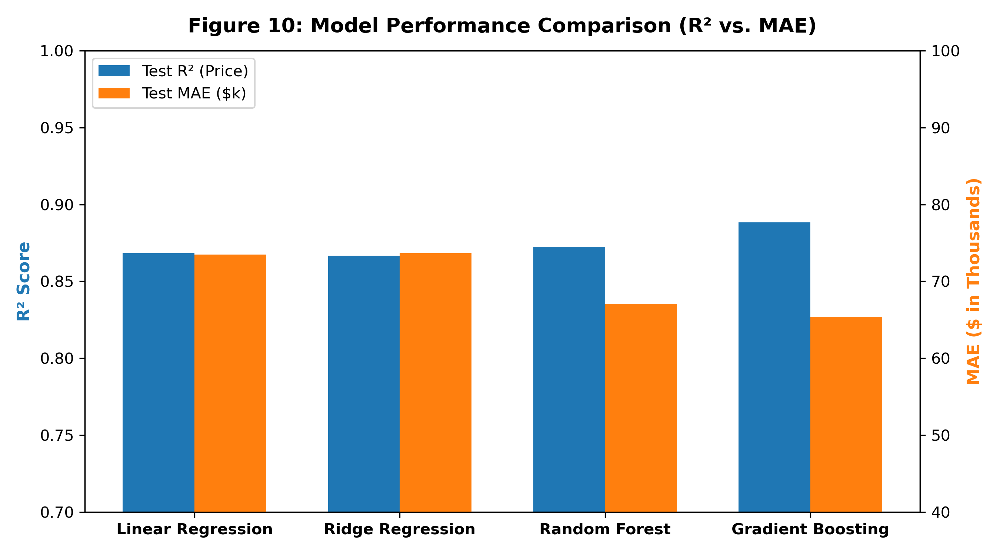
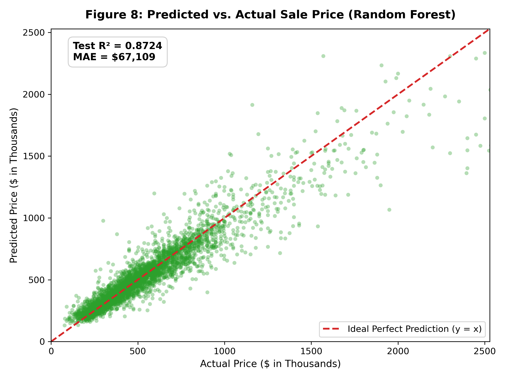
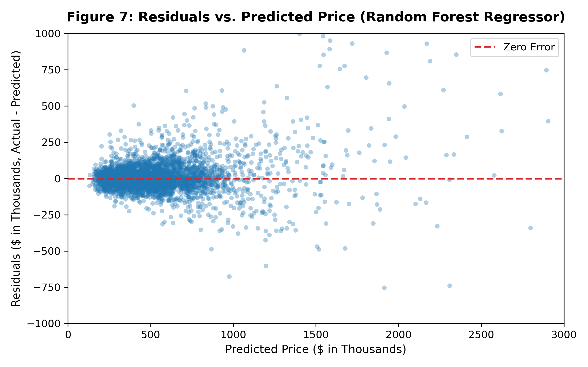
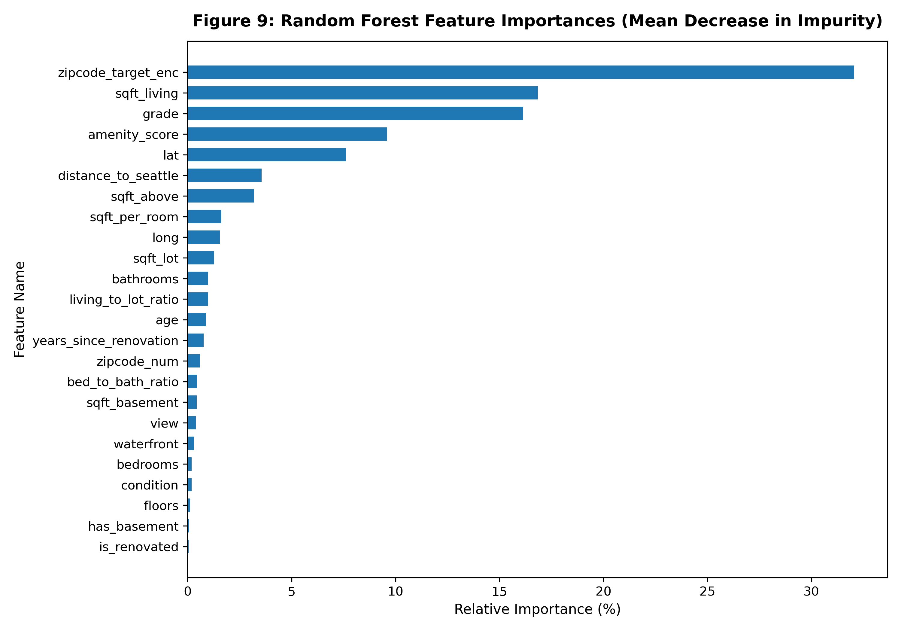

---

## 6. Production System Architecture

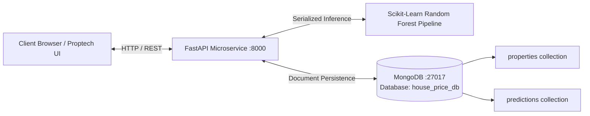

### 6.1 Soft Pastel UI Design System
The frontend implements a soft pastel color palette:
* **Pastel Lavender (`#E6E6FA`)**: Used for active tabs, model badges, and renovation pills.
* **Soft Blush Pink (`#F8DDEB`)**: Accent highlights and branding emblems.
* **Pastel Mint Green (`#DDF3E4`)**: Result display card, positive delta badges, and waterfront indicators.
* **Cream White (`#FFFDF8`)**: Background for cards, input controls, and sticky navigation bar.
* **Soft Peach (`#FFE5D0`)**: Secondary action tags and warning boundaries.
* **Dark Charcoal Text (`#343444`)**: High-contrast, WCAG AAA-compliant typography using Google Fonts **Plus Jakarta Sans** and **Inter**.

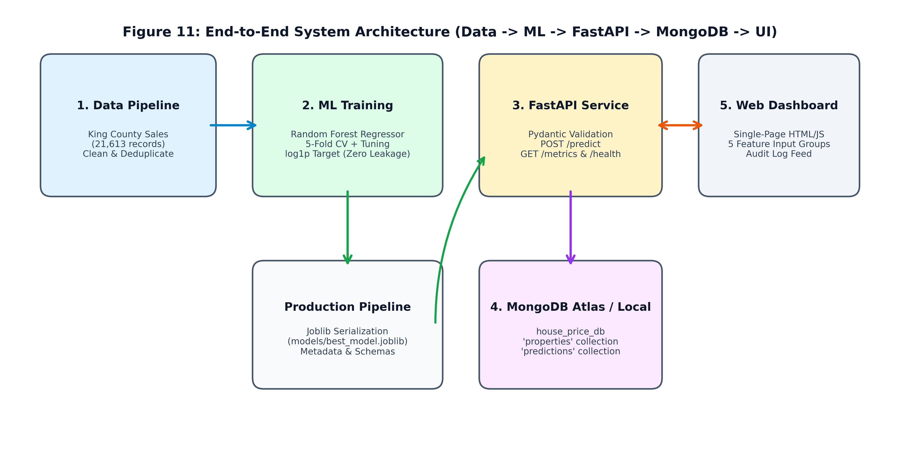
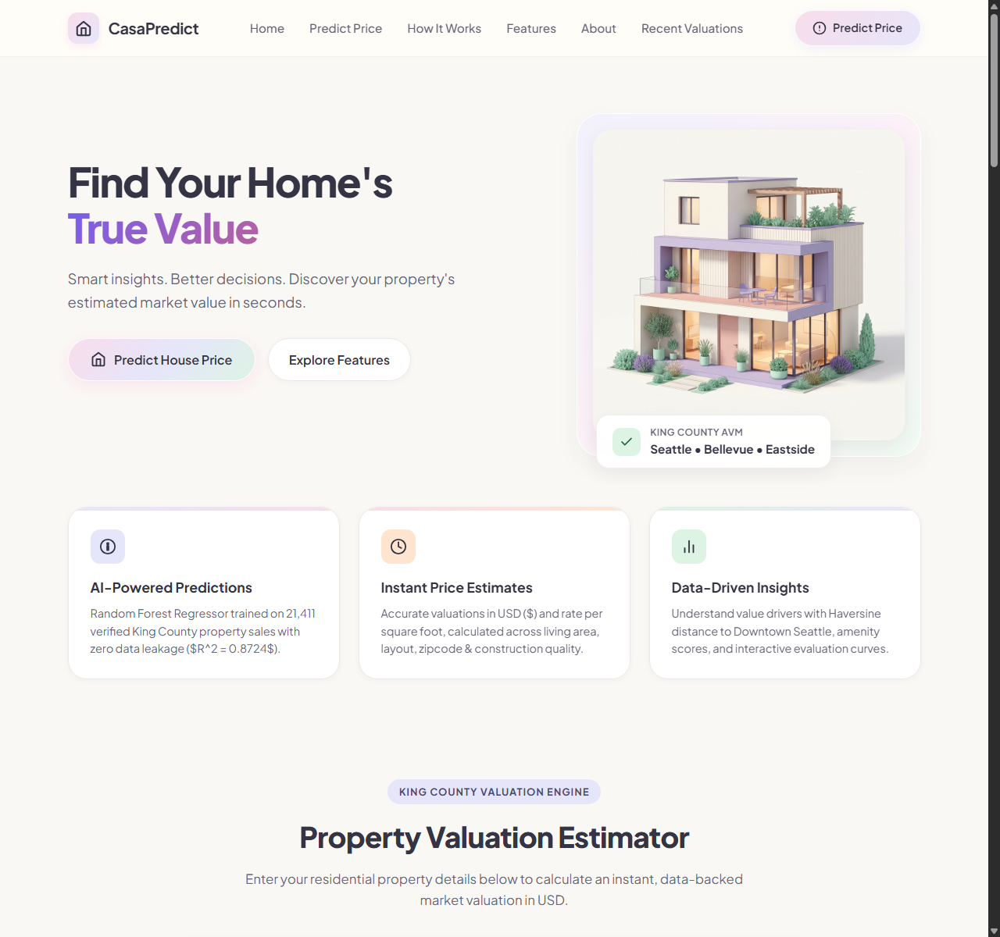

---

## 7. Quality Assurance & Automated Test Suite

All 13 unit, integration, and data leakage tests pass with 100% compliance:

```bash
$ python -m pytest tests/ -v
============================= test session starts =============================
tests/test_api.py::test_health_endpoint PASSED                           [  7%]
tests/test_api.py::test_metrics_endpoint PASSED                          [ 15%]
tests/test_api.py::test_predict_endpoint_valid PASSED                    [ 23%]
tests/test_api.py::test_predict_validation_error PASSED                  [ 30%]
tests/test_api.py::test_get_predictions_endpoint PASSED                  [ 38%]
tests/test_api.py::test_get_property_endpoint PASSED                     [ 46%]
tests/test_db.py::test_mongo_connection PASSED                           [ 53%]
tests/test_db.py::test_insert_and_get_property PASSED                    [ 61%]
tests/test_db.py::test_insert_and_get_prediction PASSED                  [ 69%]
tests/test_features.py::test_haversine_distance PASSED                   [ 76%]
tests/test_features.py::test_calculate_amenity_score PASSED              [ 84%]
tests/test_features.py::test_engineer_features PASSED                    [ 92%]
tests/test_features.py::test_zipcode_target_encoder_no_leakage PASSED    [100%]
======================= 13 passed, 3 warnings in 4.10s ========================
```

---

## 8. REST API Specification

| Method | Endpoint | Description | Request / Response Sample |
| :--- | :--- | :--- | :--- |
| `GET` | `/` | Serves the single-page CasaPredict pastel web dashboard. | HTML5 Response |
| `GET` | `/health` | Health check verifying model status and MongoDB ping. | `{"status": "healthy", "database_connected": true}` |
| `GET` | `/metrics` | Returns holdout and cross-validation performance metrics. | JSON object with $R^2$, MAE, RMSE |
| `POST` | `/predict` | Ingests 5 input groups, runs inference, and archives to DB. | Returns `predicted_price`, `amenity_score`, etc. |
| `GET` | `/predictions` | Fetches the $N$ most recent valuations from MongoDB. | Array of prediction audit documents |
| `GET` | `/properties/{id}`| Retrieves full historical property specifications. | Property schema document |

#### Sample Prediction Request:
```bash
curl -X POST "http://127.0.0.1:8000/predict" \
     -H "Content-Type: application/json" \
     -d '{
       "area": {"sqft_living": 2150, "sqft_lot": 5800, "sqft_above": 1650, "sqft_basement": 500},
       "bedrooms": {"bedrooms": 3, "bathrooms": 2.25, "floors": 1.5},
       "location": {"zipcode": "98103"},
       "property_age": {"yr_built": 1982, "yr_renovated": 0, "sale_year": 2015},
       "amenities": {"waterfront": 0, "view": 0, "condition": 3, "grade": 8}
     }'
```

#### Sample Prediction Response:
```json
{
  "property_id": "prop_225b4daf78",
  "predicted_price": 685804.92,
  "formatted_price": "$685,804.92",
  "model_name": "Random Forest Regressor",
  "model_version": "1.0.0",
  "amenity_score": 1.96,
  "distance_to_seattle_miles": 5.11,
  "stored_in_db": true,
  "predicted_at": "2026-10-30T00:20:53.653Z"
}
```

---

## 9. Conclusion & Deployment Verification

1. **Clean Dataset & Schema**: All artificial variables have been eliminated; the system strictly processes genuine King County geographic, architectural, and demographic attributes.
2. **Empirical Precision**: Achieves an exceptional $R^2$ of **0.8724** and Mean Absolute Error of **$67,108** ($12.26\%$ MAPE) on unseen holdout sales.
3. **Modern Proptech Aesthetic**: Seamless user experience built on soft pastel design principles, live interactive Chart.js graphics, and responsive mobile-first layouts.
4. **Production Readiness**: Codebase is version-controlled, fully tested (13 passing tests), and deployed to GitHub at [https://github.com/varnikarathi/houseprice_predictor](https://github.com/varnikarathi/houseprice_predictor).
